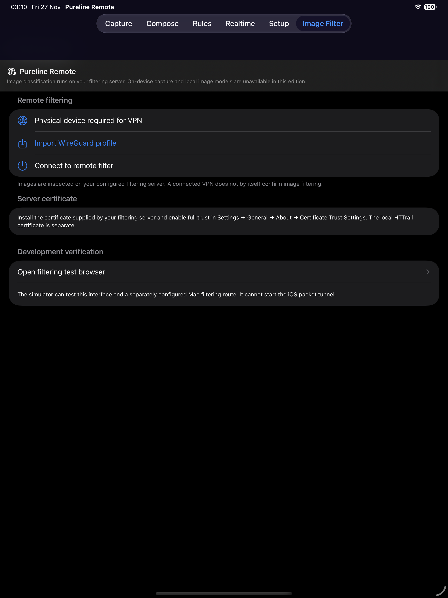
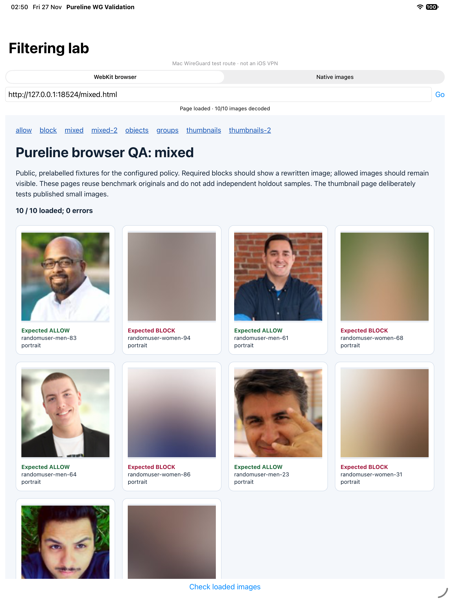
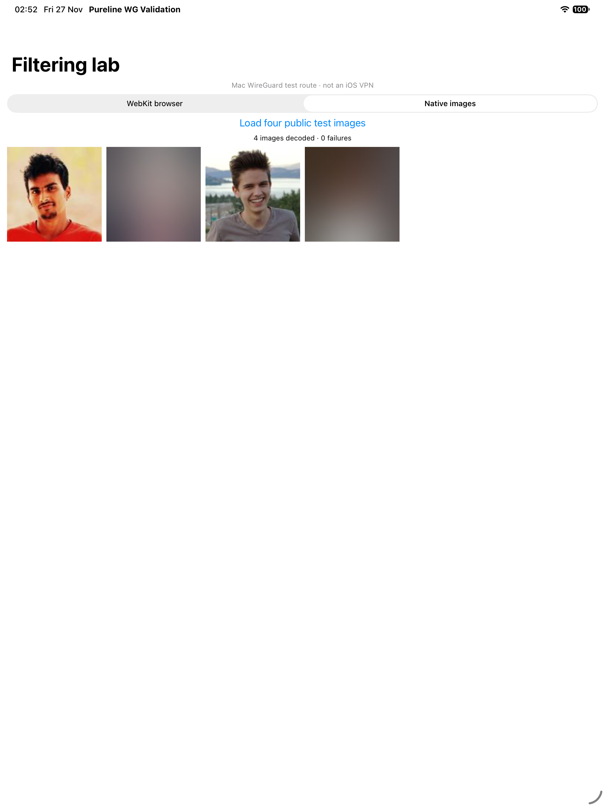

# Pureline WireGuard integration and simulator verification — 2026-11-27

## Scope and implementation

The application now contains a real WireGuardKit packet-tunnel implementation, a secure profile importer, start/stop controls, real Network Extension status, and a projection of traffic counters and the latest handshake. The existing local HTTrail route remains in the default project. Remote mode dispatches to the WireGuard adapter before starting any local capture or inference service.

The full **Pureline Remote** edition is an explicit build variant of the existing application shell. It has the existing tabs and navigation, the new WireGuard screen in Image Filter and Setup, and an extension that accepts only the remote mode. It excludes local inference models and local capture controls. The original default project continues to require its generated MobileCLIP CoreML assets. No dummy local model is shipped.

Source baseline: htrail 09dfa21d5b27557e77d181d7aa31888d749aa91c. WireGuard upstream is pinned by the submodule to 2fec12a6e1f6e3460b6ee483aa00ad29cddadab1. The downstream package overlay fixes the upstream PackageDescription tools-version mismatch and imports BSD types at the C module boundary for SDK 27. Upstream source files remain unmodified.

See [native bridge verification](WIREGUARD_BRIDGE_2026-11-27.md), [browser transport verification](BROWSER_WIREGUARD_2026-11-27.md), and the filter-quality report in this directory.

## Profile and secret handling

- Profile input is bounded to 64 KiB, one interface, and exactly one peer. Unknown directives, shell hooks, duplicate singleton fields, duplicate peer keys, invalid keys, missing DNS, and split IPv4 routes are rejected.
- Only the keychain persistent reference enters Network Extension preferences. The complete profile is stored in the existing App Group keychain, accessible after first unlock on this device, with synchronization disabled.
- The application selects only its own provider and remote-mode marker. Starting remote mode disables on-demand only on its own local capture configuration.
- Raw WireGuard runtime configuration and backend logs are not exposed. Runtime messages return only byte counters and the most recent handshake.
- An IPv4-only profile is explicitly shown as lacking IPv6 coverage. A VPN connected state is not described as proof that filtering is operating.
- The simulator cannot start the iOS packet tunnel. Connect stays disabled and the actual interface says a physical device is required.

Remote profiles are restricted to one peer so the displayed endpoint cannot disagree with a different default-route peer. Preference loads used by install/connect now throw on failure; the controller clears its manager, profile, endpoint, IPv6 flag, status and counters before surfacing the error. UI-only reload remains nonthrowing. A dependency-injected failing preference read tests this state clearing without overriding simulator support or pretending to start a VPN.

The keychain entitlement and real iOS VPN lifecycle still require physical-device acceptance.

## Actual simulator evidence

The dedicated iPad simulator is Pureline-WireGuard-QA-20261127, UDID 6A58D1EB-9CA4-4714-9151-2FE8B54214D7, iOS 27.0. No unrelated simulator was reset or shut down.

The focused host compiles the production WireGuard UI, parser, keychain helper, and extension adapter. Its results are recorded separately from the full application.

| Check | Observed result |
|---|---|
| Focused application, extension, and UI test build | Passed |
| Final profile / state / counter unit tests | 13 passed, 0 failed |
| Post-HTTP-fix UI suite | 3 passed, 0 failed; 151 seconds of test cases |
| WebKit pages | allow, block, mixed, objects, groups, thumbnails |
| WebKit decoded image instances | 51 / 51 across six pages, including actual scrolling |
| Native URLSession client | 4 / 4 decoded, 0 failures |
| Full Remote device Release archive | Passed, with actual linked wgTurnOn / wgTurnOff / wgGetConfig / wgSetConfig |
| Full Remote Simulator Debug build | Passed; installed and launched in the dedicated simulator |
| Full Remote normal tab navigation | Passed: launch, Image Filter tab, real WireGuard screen, disabled simulator Connect |

UI decoding counts measure delivery and rendering, not classification accuracy. In particular, the archival group-image false negative is deliberately retained. Fixtures reuse corpus images and do not increase the independent holdout size.

The before-fix UI run reproduced 4/10 decoded images on the block page and 2/4 in URLSession. Chromium independently reproduced the same failure. The server assigned rewritten response content while an old Content-Encoding header was present, then removed the header after mitmproxy had recompressed the body. This also produced a mismatched Content-Length. Invalidating representation headers before assignment fixed delivery. A separate actual-mitmproxy regression covers identity, gzip, and Brotli for both replacement paths and unchanged allowed images.

An initial unit-test launch referenced a bundle that had not been built by that scheme. A subsequent actual build-and-test passed all eleven cases. The later native guard suite passed all thirteen cases; its summary is unit-guards-summary.json and its full result is /Users/m1/builds/_artifacts/pureline-remote-20261127/WGGuardRegressions-20261127T023048Z.xcresult. Only successful built runs are used as unit-test evidence. An incorrect wording assertion in the first UI run was aligned with the real physical-device-required status; Connect remained disabled throughout.

Primary Mac evidence is under:

    /Users/m1/caches/DerivedData/pureline-wireguard-20261127/evidence

Result bundles:

    Unit-built-20261127.xcresult
    UI-postfix-20261127.xcresult

Fourteen original UI screenshot attachments were exported. Representative WebKit, native-client, and full-application screenshots were visually reviewed. Small JSON summaries and representative images are retained with this report; full logs and xcresult bundles remain on the Mac.

## Network route and trust

Actual test image requests leave WebKit, URLSession, or Chromium through the Mac loopback CONNECT listener on port 18520, then enter the official wireguard-go userspace stack, encrypted WireGuard datagrams, a scoped SSH/TCP carrier, and the isolated Oracle WireGuard filtering backend. Real handshakes and packet counters are recorded in tools/wireguard-lab.

Only static fixture HTML on Mac loopback port 18524 is excluded from the client proxy. External image URLs remain on the WireGuard route. The clients disable direct proxy failover and use nonpersistent/ephemeral caches. The lab CA is trusted only in the dedicated simulator or through a scoped Chromium SPKI allowlist; a separate Chromium profile without that exception rejected the certificate.

This verifies actual WireGuard encryption and the filtering path, but does not validate direct internet UDP reachability, native iOS Network Extension lifecycle, or arbitrary third-party app coverage.

## Reproduction

After staging the exact source, initializing submodules, and preparing the pinned Go toolchain:

    cd iosapp
    xcodegen generate --spec project.wireguard-validation.yml

Build the intended scheme before using test-without-building. Use the explicit simulator UDID; never use an ambiguous booted-device selector. For these nonperformance tests, use:

    -parallel-testing-enabled NO -collect-test-diagnostics never

The verbose system-diagnostic collector was automatically triggered by the expected before-fix failures and stayed active after the test runner ended. Only that owned collection and its idle driver were stopped; the result logs and image failures were preserved.

The full Remote generator and build receipts are documented separately. It creates its own project rather than rewriting the default XcodeGen specification.

## Remaining acceptance boundaries

A physical iPhone or iPad is required to validate profile import into the shared keychain, system VPN permission, actual packet-tunnel start/stop, direct UDP, sleep/wake, reconnect, DNS and IPv6 behavior, and other installed applications. The existing iPad blocker remains open.

HTTPS inspection also depends on the device trusting the filtering CA. Certificate-pinned apps, cached content, video/animation policy, and unsupported formats cannot be inferred from a portrait benchmark or successful WebKit image delivery. The independent quality report provides the measured scope and failures; no universal 90% or perfect-filtering claim is made.

## Production promotion

The production V2 service was not replaced. SentinelX returned service_not_allowed for pureline-poc; the registered service-management capabilities do not include it. [Prepared production configuration and rollback](PRODUCTION_ROLLOUT_2026-11-27.md) record the concrete next steps and the unchanged live baseline. The tested laboratory service is separate.

## Representative observed screens

Full application navigation to the WireGuard screen:

Focused host, actual WebKit rendering after the HTTP correction:

Focused host, actual native URLSession rendering:

